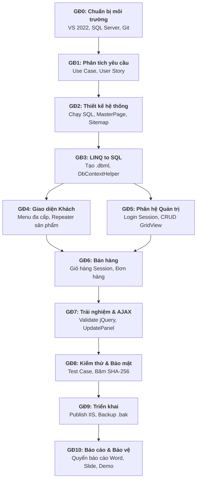

# TÀI LIỆU TOÀN DIỆN HƯỚNG DẪN DỰ ÁN BÀI TẬP LỚN: WEBSITE BÁN ĐỒNG HỒ
**Môn học:** Lập trình Web (1221IN412402 - 3 Tín chỉ)  
**Trường:** Đại học Đồng Tháp - Khoa Công nghệ Thông tin  
**Giảng viên:** Thầy Lương Thái Ngọc  
**Công nghệ:** ASP.NET Web Forms (.NET Framework 4.8 / C#), LINQ to SQL (.dbml), Microsoft SQL Server 2022  

---

# MỤC LỤC TỔNG QUAN
1. [BỐI CẢNH DỰ ÁN & ĐẶC TẢ CƠ SỞ DỮ LIỆU](#1-bối-cảnh-dự-án--đặc-tả-cơ-sở-dữ-liệu)
2. [PHẦN 1: TỔNG QUAN QUY TRÌNH PHÁT TRIỂN DỰ ÁN](#phần-1-tổng-quan-quy-trình-phát-triển-dự-án)
3. [PHẦN 2: CHI TIẾT 11 GIAI ĐOẠN PHÁT TRIỂN (GĐ0 – GĐ10)](#phần-2-chi-tiết-11-giai-đoạn-phát-triển-gđ0--gđ10)
4. [PHẦN 3: ÁNH XẠ VỚI ĐỀ CƯƠNG MÔN HỌC (CHƯƠNG 1 - 6)](#phần-3-ánh-xạ-với-đề-cương-môn-học-chương-1---6)
5. [PHẦN 4: THỨ TỰ VÀ CÁC MỐC HOÀN THÀNH (MILESTONES)](#phần-4-thứ-tự-và-các-mốc-hoàn-thành-milestones)
6. [PHẦN 5: QUẢN LÝ LÀM VIỆC NHÓM 2 NGƯỜI & GIT/GITHUB CHỐNG XUNG ĐỘT](#phần-5-quản-lý-làm-việc-nhóm-2-người--gitgithub-chống-xung-đột)
7. [PHẦN 6: DANH MỤC SẢN PHẨM BÀN GIAO & ĐỀ CƯƠNG BÁO CÁO WORD](#phần-6-danh-mục-sản-phẩm-bàn-giao--đề-cương-báo-cáo-word)
8. [PHẦN 7: TIÊU CHÍ ĐÁNH GIÁ, RUBRIC CHẤM ĐIỂM (5.0) & CHECKLIST](#phần-7-tiêu-chí-đánh-giá-rubric-chấm-điểm-50--checklist)
9. [PHẦN 8: BẢNG QUẢN TRỊ 8+ RỦI RO KỸ THUẬT & CÁCH KHẮC PHỤC](#phần-8-bảng-quản-trị-8-rủi-ro-kỹ-thuật--cách-khắc-phục)
10. [PHẦN 9: PHỤ LỤC CODE MẪU HOÀN CHỈNH, TEST CASE & NHẬT KÝ](#phần-9-phụ-lục-code-mẫu-hoàn-chỉnh-test-case--nhật-ký)

---

# 1. BỐI CẢNH DỰ ÁN & ĐẶC TẢ CƠ SỞ DỮ LIỆU

## 1.1. Bối cảnh
- **Học phần:** Lập trình Web (30 tiết lý thuyết + 30 tiết thực hành).
- **Cơ cấu điểm:** Chuyên cần 10% (1.0đ), Kiểm tra/Báo cáo chuyên đề 40% (4.0đ), **Báo cáo Bài tập lớn cuối môn 50% (5.0đ)**.
- **Quy định công nghệ:** ASP.NET Web Forms (.aspx), C#, LINQ to SQL (.dbml), Microsoft SQL Server 2022. Tuyệt đối không dùng ASP.NET Core, MVC hay Entity Framework để đúng chuẩn nội dung giảng dạy.

## 1.2. Ánh xạ nghiệp vụ trên 3 Bảng lõi
Tên Database: `layout`. Bắt buộc giữ nguyên 100% tên bảng và tên cột theo chuẩn đề cương:
1. **Bảng `Menus`** (Khóa chính: `ID_MN`):
   - Quản lý cây danh mục đa cấp. Cột `Parent` xác định cấp cha/con (Parent = 0 là gốc, Parent > 0 là thương hiệu con như Casio, Seiko, Rolex...).
   - Cột `Pos` xác định vị trí hiển thị (1: Menu ngang Header, 2: Sidebar danh mục, 3: Footer).
   - Cột `Hide` ẩn/hiện danh mục (0: hiện, 1: ẩn).
2. **Bảng `PageItems`** (Khóa chính: `ID_P`):
   - Lưu trữ sản phẩm đồng hồ và tin tức. Liên kết với `Menus` qua `ID_MN` (FK **NO ACTION** — không cho xóa menu khi còn sản phẩm/bài viết thuộc menu đó, hãy dùng `Menus.Hide = 1` để ẩn).
   - Cột `Title`: Tên đồng hồ. Cột `Sumary`: **CHỈ chứa tóm tắt mô tả** (KHÔNG còn chứa giá — giá lấy duy nhất từ bảng `ProductPrices.Price`). Cột `Contents`: Mô tả chi tiết, thông số kỹ thuật (vỏ thép, kính Sapphire, độ chịu nước).
   - Cột `Image`: Tên file ảnh đại diện (lưu tại `/Assets/images/products/`).
   - Cột `Gender` **(MỚI v2)**: Phân loại giới tính (`0`: Unisex/Không áp dụng, `1`: Nam, `2`: Nữ) — dùng để lọc sản phẩm theo trang "Đồng hồ Nam" / "Đồng hồ Nữ" qua query string `?gender=1` hoặc `?gender=2`.
   - Cột `ItemType` **(MỚI v2)**: Phân loại nội dung (`1`: Sản phẩm, `2`: Tin tức/Bài viết) — giúp tách biệt rõ ràng giữa sản phẩm bán hàng và tin tức đánh giá trên cùng 1 bảng.
   - Cột `Hide`: **Chỉ có nghĩa "ẩn khỏi website"** (`0`: Hiển thị, `1`: Ẩn). Hết hàng xác định bằng `ProductPrices.StockQuantity = 0`, không dùng `Hide`.
3. **Bảng `Acounts`** (Khóa chính: `Username`):
   - Quản lý tài khoản đăng nhập. `Permission`: 1 = Admin (toàn quyền), 2 = Khách hàng (Member). Có ràng buộc CHECK chỉ cho phép giá trị 1 hoặc 2.
   - `Lock`: 0 = hoạt động, 1 = bị khóa. `Active`: 1 = đã kích hoạt.

## 1.3. Giải pháp Bán hàng (Giá, Giỏ hàng, Đơn hàng)
- **Nguyên tắc v2:** Cột `Sumary` trong `PageItems` **CHỈ chứa tóm tắt mô tả thuần túy** (không chứa giá). Toàn bộ thông tin giá bán lấy duy nhất từ bảng `ProductPrices.Price`.
- Giữ nguyên 100% 3 bảng lõi theo đề cương, bổ sung 3 bảng mở rộng độc lập:
  + `ProductPrices`: Quan hệ 1-1 với `PageItems` qua `ID_P` (lưu `Price`, `OriginalPrice`, `StockQuantity`, `DiscountPercent`). Có các ràng buộc CHECK: giá ≥ 0, tồn kho ≥ 0, % khuyến mãi 0–100, giá bán ≤ giá niêm yết.
  + `Orders`: Quản lý đơn đặt hàng. Có ràng buộc CHECK trạng thái chỉ nhận 5 giá trị: `Chờ xử lý`, `Đã xác nhận`, `Đang giao`, `Đã hoàn tất`, `Đã hủy`.
  + `OrderDetails`: Chi tiết từng sản phẩm trong đơn hàng. Có ràng buộc UNIQUE `(OrderID, ID_P)` đảm bảo mỗi sản phẩm chỉ xuất hiện 1 dòng trong 1 đơn.
- **Quy chuẩn đồng bộ:** File script `Database_layout.sql` (phiên bản v2) đã được tạo sẵn tại thư mục gốc dự án. Mở SSMS và nhấn **F5** để tạo trọn gói CSDL.

---

# PHẦN 1: TỔNG QUAN QUY TRÌNH PHÁT TRIỂN DỰ ÁN

## 1.1. Mô hình phát triển: Iterative & Incremental (Lặp tăng tiến)
Áp dụng cho nhóm 2 sinh viên mới bắt đầu:
- Chia nhỏ dự án thành các vòng lặp chức năng: Khung trang & Kết nối CSDL → Giao diện hiển thị phía Khách → Phân hệ Quản trị Admin → Giỏ hàng & Đặt hàng → Tối ưu & Báo cáo.
- Đảm bảo sau mỗi vòng lặp luôn có phiên bản chạy được (F5 không lỗi), tránh ghép code dồn cục vào ngày cuối.

## 1.2. Sơ đồ Mermaid 11 Giai đoạn (GĐ0 – GĐ10)



---

# PHẦN 2: CHI TIẾT 11 GIAI ĐOẠN PHÁT TRIỂN (GĐ0 – GĐ10)

### GĐ0: Chuẩn bị môi trường & Khởi tạo dự án
- **Mục tiêu:** Cài đặt công cụ chuẩn, cấu hình Git, thiết lập thư mục dự án.
- **Công cụ:** Visual Studio 2022 Community, SQL Server 2022, SSMS, Git.
- **Các bước:**
  1. Mở Visual Studio Installer → Modify → Tích chọn `ASP.NET and web development`. Chuyển qua tab `Individual components` tìm và tích bắt buộc `LINQ to SQL tools`.
  2. Tạo project mới: Chọn `ASP.NET Web Application (.NET Framework)` C#, đặt tên `BCBTL`, chọn `.NET Framework 4.8`, mẫu `Empty` + tích `Web Forms`.
  3. Tạo thư mục con: `/Assets/css/`, `/Assets/js/`, `/Assets/images/products/`, `/Admin/`, `/App_Code/`.
  4. Tạo Git Repository kết nối GitHub của nhóm.
- **DoD:** Solution biên dịch thành công 0 lỗi.

### GĐ1: Phân tích yêu cầu & Use Case
- **Mục tiêu:** Liệt kê tường minh chức năng hệ thống cho Khách và Admin.
- **Đầu ra:** Danh sách Use Case và bảng User Story phân vai rõ ràng cho 2 thành viên.

### GĐ2: Thiết kế hệ thống & MasterPage
- **Mục tiêu:** Thiết lập cấu trúc giao diện thống nhất qua MasterPage.
- **Các bước:**
  1. Mở SSMS, mở file `Database_layout.sql` vừa tạo trong thư mục dự án và nhấn **F5** để khởi tạo database `layout`.
  2. Tạo `Site.Master` ở thư mục gốc cho khách hàng (Header, Thanh tìm kiếm, Menu ngang đa cấp, Giỏ hàng, ContentPlaceHolder, Footer).
  3. Tạo `Admin.Master` trong thư mục `/Admin/` cho quản trị viên (Sidebar trái điều hướng chức năng, Topbar hiển thị thông tin admin, ContentPlaceHolder thao tác dữ liệu).

### GĐ3: Kết nối CSDL bằng LINQ to SQL (.dbml)
- **Mục tiêu:** Ánh xạ 6 bảng SQL thành lớp đối tượng C# và tạo lớp kết nối tập trung.
- **Các bước:**
  1. Mở Server Explorer (Ctrl + Alt + S) → Add Connection kết nối database `layout`.
  2. Chuột phải Project → Add → New Item → LINQ to SQL Classes → Đặt tên `WatchStore.dbml`.
  3. Kéo thả 6 bảng (`Acounts`, `Menus`, `PageItems`, `ProductPrices`, `Orders`, `OrderDetails`) từ Server Explorer vào designer rồi lưu lại (Ctrl + S).
  4. Thêm connectionStrings vào `Web.config`:
     ```xml
     <connectionStrings>
       <add name="WatchStoreConnectionString" connectionString="Data Source=.;Initial Catalog=layout;Integrated Security=True;Encrypt=False" providerName="System.Data.SqlClient" />
     </connectionStrings>
     ```
  5. Viết lớp `DbContextHelper.cs` (Xem chi tiết ở Phụ lục 9.3 - Mẫu 1).

### GĐ4: Lập trình giao diện Khách hàng
- **Mục tiêu:** Hiển thị menu động và danh sách đồng hồ.
- **Các bước:**
  1. Viết code dựng Menu đa cấp tự động đọc từ bảng `Menus` (xem Phụ lục 9.3 - Mẫu 2).
  2. Trang `Default.aspx`: Hiển thị Banner quảng cáo và danh sách 6 mẫu đồng hồ mới nhất (`ItemType = 1`) bằng Server Control `Repeater`.
  3. Trang `ProductList.aspx`: Nhận `idmn` từ URL query string để lọc đồng hồ theo thương hiệu (Casio, Seiko...), hoặc nhận `gender` để lọc theo giới tính (`gender=1`: Đồng hồ Nam, `gender=2`: Đồng hồ Nữ) — sử dụng cột `PageItems.Gender` (v2).
  4. Trang `ProductDetail.aspx`: Nhận `id` sản phẩm, hiển thị ảnh lớn, giá bán (lấy từ `ProductPrices.Price`), thông số kỹ thuật và nút "Thêm vào giỏ hàng".

### GĐ5: Lập trình phân hệ Quản trị (Admin)
- **Mục tiêu:** Quản trị đăng nhập, phân quyền và CRUD danh mục/sản phẩm.
- **Các bước:**
  1. Xây dựng trang `Login.aspx` kiểm tra `Permission = 1`, `Lock = 0` và lưu `Session["AdminUser"] = user.Username`.
  2. Kiểm tra phân quyền trong sự kiện `Page_Load` của `Admin.Master` (nếu Session rỗng thì tự động chuyển hướng về `Login.aspx`).
  3. Trang `ManageProducts.aspx`: Dùng `GridView` hỗ trợ phân trang (`AllowPaging="True"`), sắp xếp, xóa có xác nhận JavaScript (`OnClientClick="return confirm('...');"`), upload ảnh bằng `FileUpload` lưu vào thư mục `/Assets/images/products/` (Xem Phụ lục 9.3 - Mẫu 4).

### GĐ6: Lập trình chức năng Bán hàng (Giỏ hàng & Đặt hàng)
- **Mục tiêu:** Khách chọn mua sản phẩm, cập nhật số lượng và gửi đơn đặt hàng.
- **Các bước:**
  1. Xây dựng lớp đối tượng `CartItem.cs` lưu trữ trong `Session["Cart"]` (Xem Phụ lục 9.3 - Mẫu 5).
  2. Trang `Cart.aspx`: Dùng `GridView` hoặc `Repeater` hiển thị giỏ hàng, cho phép sửa số lượng, xóa từng món, nút "Xóa hết" và tính tổng tiền.
  3. Trang `Checkout.aspx`: Thu thập thông tin khách (Họ tên, SĐT, Địa chỉ) → Lưu bản ghi vào bảng `Orders` → Lặp từng món trong giỏ hàng để lưu vào bảng `OrderDetails` → Xóa giỏ hàng Session → Chuyển sang trang `OrderSuccess.aspx`.

### GĐ7: Nâng cao trải nghiệm (Validation, jQuery & ASP.NET AJAX)
- **Mục tiêu:** Kiểm tra dữ liệu hợp lệ và tăng tốc thao tác người dùng.
- **Các bước:**
  1. Sử dụng Server Controls: `RequiredFieldValidator` (bắt buộc nhập họ tên, địa chỉ), `RegularExpressionValidator` (kiểm tra định dạng SĐT 10 số).
  2. Sử dụng `ScriptManager` và `UpdatePanel` trong `Cart.aspx` để khi tăng/giảm số lượng sản phẩm thì chỉ cập nhật phần tiền mà không cần tải lại toàn bộ trang web (F5 ngầm).

### GĐ8: Kiểm thử & Bảo mật cơ bản
- **Mục tiêu:** Phát hiện lỗi trước khi nộp và đảm bảo an toàn dữ liệu.
- **Các bước:**
  1. Băm mật khẩu bảng `Acounts`: Áp dụng giải thuật băm **SHA-256** (không bao giờ lưu mật khẩu dạng văn bản thô).
  2. Cơ chế chống SQL Injection: LINQ to SQL đã tự động tham số hóa (Parameterized Query) 100% câu truy vấn.
  3. Chống XSS: Khi hiển thị thông tin do người dùng nhập, luôn dùng `Server.HtmlEncode()` hoặc điều khiển `Label` (tự động encode).
  4. Thực hiện 10 bộ Test Case mẫu (xem Phụ lục 9.4).

### GĐ9: Triển khai (Deployment lên IIS & Backup CSDL)
- **Mục tiêu:** Cấu hình website chạy trực tiếp trên máy chủ web cục bộ IIS.
- **Các bước:**
  1. Bật tính năng IIS trên Windows: Control Panel → Programs and Features → Turn Windows features on or off → Tích chọn `Internet Information Services` và `.NET Framework 4.8 Advanced Services`.
  2. Visual Studio: Chuột phải Project `BCBTL` → Chọn **Publish** → Chọn đích đến là **Folder** (Ví dụ: `D:\Publish\WatchStore`).
  3. Mở IIS Manager → Chuột phải `Sites` → `Add Website` → Trỏ Physical path về thư mục đã Publish.
  4. Trong SSMS: Chuột phải database `layout` → Tasks → Back Up... → Xuất file `layout.bak` để nộp kèm mã nguồn.

### GĐ10: Báo cáo & Bảo vệ đồ án
- **Mục tiêu:** Hoàn thiện hồ sơ báo cáo Word và thực hành demo đạt điểm tối đa.
- **Sản phẩm:** Quyển báo cáo Word theo chuẩn trường ĐH Đồng Tháp, slide thuyết trình PowerPoint và kịch bản phân vai 10-15 phút.

---

# PHẦN 3: ÁNH XẠ VỚI ĐỀ CƯƠNG MÔN HỌC (CHƯƠNG 1 - 6)

| Chương lý thuyết môn học | Nội dung cốt lõi | Áp dụng trong Dự án BTL | Sản phẩm cụ thể kiểm chứng |
| :--- | :--- | :--- | :--- |
| **Chương 1:** Tổng quan Web & Webserver | Mô hình Client/Server, Cài đặt IIS, Cấu trúc dự án ASP.NET | Cấu hình thư mục chuẩn, chạy thử IIS cục bộ, cấu hình `Web.config` | Project ASP.NET Web Forms biên dịch thành công, chạy được trên IIS |
| **Chương 2:** HTML, CSS & Layout | Thẻ HTML, định dạng CSS, bố cục Menu đa cấp | Thiết kế giao diện `Site.Master`, định dạng lưới sản phẩm, CSS Menu hover | File `Site.Master`, `style.css`, giao diện responsive bắt mắt |
| **Chương 3:** C# & Kết nối CSDL | Biến, vòng lặp, hàm, ADO.NET / LINQ to SQL, CRUD CSDL | Lớp `DbContextHelper.cs`, viết hàm truy vấn LINQ to SQL lấy sản phẩm và danh mục | File `WatchStore.dbml`, các thao tác `InsertOnSubmit`, `SubmitChanges` |
| **Chương 4:** Các điều khiển thường dùng | Button, TextBox, DropDownList, FileUpload, GridView, Repeater | Form thêm sản phẩm kèm upload ảnh, GridView quản lý sản phẩm có phân trang | `ManageProducts.aspx` có `FileUpload` và `GridView` xóa có confirm |
| **Chương 5:** Đối tượng nâng cao & Phiên | Request, Response, Session, Application, Cookies | `Session["Cart"]` giỏ hàng, `Session["AdminUser"]` đăng nhập, `Request.QueryString` | Chức năng Đăng nhập - Đăng xuất, Lưu giỏ hàng không mất khi đổi trang |
| **Chương 6:** Tối ưu hóa website | JavaScript, jQuery, Ajax UpdatePanel | Kiểm tra form nhập liệu bằng JS, Ajax UpdatePanel cập nhật giỏ hàng êm ái | Form đặt hàng kiểm tra SĐT hợp lệ, cập nhật số lượng không giật màn hình |

### So sánh LINQ to SQL với ADO.NET thuần (Dành cho vấn đáp)
* Khi giảng viên hỏi: *"Tại sao trong đề cương có ADO.NET mà nhóm lại sử dụng LINQ to SQL?"*:
  - **Trả lời:** LINQ to SQL là công nghệ ORM cao cấp được xây dựng **trực tiếp bên trên nền tảng ADO.NET**. Thay vì phải mở kết nối thủ công (`SqlConnection`), viết câu lệnh SQL dạng chuỗi dễ sai chính tả (`SqlCommand`) và đọc từng dòng (`SqlDataReader`), LINQ to SQL trừu tượng hóa CSDL thành các đối tượng C# mạnh mẽ, hỗ trợ bắt lỗi ngay khi gõ phím (Compile-time checking), tự động chống tấn công SQL Injection và rút ngắn 60% lượng code phải viết. Về bản chất, khi thực thi, `DataContext` vẫn tự động sinh ra các lệnh ADO.NET tương ứng xuống SQL Server.

---

# PHẦN 4: THỨ TỰ VÀ CÁC MỐC HOÀN THÀNH (MILESTONES)

| Mốc (Milestone) | Tên mục tiêu | Sản phẩm cần Demo được | Checklist Tiêu chí hoàn thành (Done) |
| :---: | :--- | :--- | :--- |
| **Mốc 1** | Khung nền tảng | Kết nối CSDL thành công | [x] Chạy script SQL tạo đủ 6 bảng<br>[x] Tạo `WatchStore.dbml` kéo đủ 6 bảng<br>[x] Chạy thử `Default.aspx` kết nối được DB |
| **Mốc 2** | Giao diện Khách hàng | Duyệt xem sản phẩm mượt mà | [x] Menu đa cấp hiển thị đúng phân cấp cha-con<br>[x] Xem danh sách đồng hồ theo hãng<br>[x] Xem chi tiết đồng hồ đầy đủ ảnh, giá, mô tả |
| **Mốc 3** | Quản trị Admin | Đăng nhập và CRUD sản phẩm | [x] Đăng nhập đúng tài khoản/mật khẩu bảng `Acounts`<br>[x] Thêm sản phẩm mới kèm upload ảnh thành công<br>[x] Sửa, xóa sản phẩm trực tiếp trên GridView |
| **Mốc 4** | Nghiệp vụ Bán hàng | Mua hàng & Lưu đơn hoàn chỉnh | [x] Thêm vào giỏ hàng lưu bằng Session<br>[x] Sửa số lượng, xóa món trong giỏ hàng<br>[x] Đặt hàng lưu thành công vào `Orders` & `OrderDetails` |
| **Mốc 5** | Hoàn thiện & Bảo vệ | Triển khai & Tài liệu | [x] Tích hợp Ajax UpdatePanel giỏ hàng<br>[x] Publish chạy tốt trên IIS<br>[x] Hoàn thiện file Báo cáo Word và Slide thuyết trình |

---

# PHẦN 5: QUẢN LÝ LÀM VIỆC NHÓM 2 NGƯỜI & GIT/GITHUB CHỐNG XUNG ĐỘT

## 5.1. Phân chia công việc theo Module độc lập
* **Thành viên A (Phụ trách Phân hệ Khách hàng & Bán hàng):**
  - Thiết kế `Site.Master`, CSS giao diện người dùng.
  - Xây dựng: `Default.aspx`, `ProductList.aspx`, `ProductDetail.aspx`.
  - Xây dựng module Giỏ hàng & Đặt hàng: `Cart.aspx`, `Checkout.aspx`, `OrderSuccess.aspx`.
* **Thành viên B (Phụ trách Phân hệ Quản trị Admin & CSDL):**
  - Viết và bảo trì script SQL Server, quản lý file `WatchStore.dbml`.
  - Thiết kế `Admin.Master`, bảo mật phân quyền kiểm tra Session.
  - Xây dựng module Admin: `Login.aspx`, `ManageMenus.aspx`, `ManageProducts.aspx`, `ManageOrders.aspx`.

## 5.2. Quy tắc sống còn chống xung đột (Conflict) trên ASP.NET Web Forms
1. **Không cùng sửa file cấu hình và project:** File `BCBTL.csproj` và `Web.config` chỉ nên để một người (Trưởng nhóm - Thành viên B) chỉnh sửa khi cần add thêm thư viện mới.
2. **Quy tắc vàng với file `.dbml`:** File `WatchStore.dbml` và `WatchStore.designer.cs` rất dễ xung đột nếu cả 2 người cùng sửa. **Quy định:** Chỉ Thành viên B được quyền mở file `.dbml` kéo thả bảng. Khi có thay đổi DB, Thành viên B cập nhật, commit lên Git, sau đó Thành viên A chỉ việc `git pull` về dùng.
3. **Tuyệt đối không đẩy file database (`.mdf`, `.ldf`):** Chia sẻ CSDL hoàn toàn bằng file script văn bản `Database_layout.sql`.

## 5.3. Quy trình Git chuẩn cho 2 thành viên
- Khi bắt đầu phiên làm việc: Luôn chạy lệnh `git pull origin main` để cập nhật code mới nhất của bạn mình.
- Khi làm xong một chức năng:
  ```bash
  git add .
  git commit -m "feat(cart): Hoan thien chuc nang cap nhat so luong gio hang"
  git push origin main
  ```

---

# PHẦN 6: DANH MỤC SẢN PHẨM BÀN GIAO & ĐỀ CƯƠNG BÁO CÁO WORD

## 6.1. Danh mục sản phẩm nộp cuối kỳ
1. Thư mục Source Code đầy đủ của dự án (đã xóa thư mục `bin` và `obj` để giảm dung lượng khi nén).
2. File script CSDL `Database_layout.sql` và file sao lưu `layout.bak`.
3. File Báo cáo bài tập lớn định dạng Microsoft Word (`.docx`) và PDF.
4. File Slide thuyết trình báo cáo PowerPoint (`.pptx`).

## 6.2. Đề cương chi tiết Mục lục Báo cáo BTL (Chuẩn ĐH Đồng Tháp)

```
TRANG BÌA (Theo mẫu chuẩn ĐH Đồng Tháp)
LỜI CẢM ƠN
MỤC LỤC & DANH MỤC HÌNH ẢNH / BẢNG BIỂU

CHƯƠNG 1: GIỚI THIỆU TỔNG QUAN ĐỀ TÀI
  1.1. Lý do chọn đề tài (Website bán đồng hồ trực tuyến)
  1.2. Mục tiêu và phạm vi của đề tài
  1.3. Khảo sát và phân tích 5 website bán đồng hồ thực tế tại Việt Nam
       (Thế Giới Di Động, Galle Watch, Đồng Hồ Hải Triều, Xwatch, Đăng Quang Watch)
  1.4. Phân tích ưu nhược điểm của website tốt nhất và website hạn chế nhất
  1.5. Định vị và giải pháp của website nhóm tự xây dựng

CHƯƠNG 2: CƠ SỞ LÝ THUYẾT VÀ CÔNG NGHỆ ÁP DỤNG
  2.1. Tổng quan nền tảng ASP.NET Web Forms (.NET Framework 4.8)
  2.2. Kỹ thuật ORM LINQ to SQL và mô hình ánh xạ đối tượng (.dbml)
  2.3. Hệ quản trị CSDL Microsoft SQL Server 2022
  2.4. Công nghệ hỗ trợ: HTML5, CSS3, JavaScript, jQuery, ASP.NET AJAX

CHƯƠNG 3: PHÂN TÍCH VÀ THIẾT KẾ HỆ THỐNG
  3.1. Phân tích yêu cầu chức năng (Phân hệ Khách hàng & Phân hệ Quản trị)
  3.2. Sơ đồ Use Case tổng quát và chi tiết
  3.3. Thiết kế Cơ sở dữ liệu:
       3.3.1. Đặc tả các bảng lõi (Acounts, Menus, PageItems)
       3.3.2. Đặc tả các bảng mở rộng bán hàng (ProductPrices, Orders, OrderDetails)
       3.3.3. Sơ đồ quan hệ thực thể (Database Diagram)
  3.4. Thiết kế giao diện (Site Map, Wireframe, Bố cục MasterPage)

CHƯƠNG 4: KẾT QUẢ XÂY DỰNG WEBSITE VÀ THỬ NGHIỆM
  4.1. Giao diện và chức năng phân hệ Khách hàng:
       4.1.1. Trang chủ và Menu điều hướng đa cấp động
       4.1.2. Xem danh sách theo thương hiệu và tìm kiếm sản phẩm
       4.1.3. Chi tiết sản phẩm, Giỏ hàng Session và Đặt hàng
  4.2. Giao diện và chức năng phân hệ Quản trị (Admin):
       4.2.1. Đăng nhập và phân quyền bảo mật
       4.2.2. Quản lý danh mục Menu (Thêm, Sửa, Xóa)
       4.2.3. Quản lý sản phẩm đồng hồ kèm upload hình ảnh (GridView)
       4.2.4. Quản lý và duyệt trạng thái đơn hàng
  4.3. Kết quả kiểm thử hệ thống (Bảng Test Cases)

CHƯƠNG 5: KẾT LUẬN VÀ HƯỚNG PHÁT TRIỂN
  5.1. Những kết quả đã đạt được
  5.2. Những hạn chế tồn tại
  5.3. Hướng phát triển trong tương lai (Tích hợp cổng thanh toán online VNPay, Momo)

TÀI LIỆU THAM KHẢO
PHỤ LỤC: BẢNG PHÂN CÔNG CÔNG VIỆC VÀ TỶ LỆ ĐÓNG GÓP CỦA THÀNH VIÊN
```

---

# PHẦN 7: TIÊU CHÍ ĐÁNH GIÁ, RUBRIC CHẤM ĐIỂM (5.0) & CHECKLIST

### Rubric chấm điểm Bài tập lớn (Thang điểm 5.0)

| Tiêu chí đánh giá | Trọng số | Mức Khá (3.5 – 4.0 điểm) | Mức Giỏi / Xuất sắc (4.5 – 5.0 điểm) |
| :--- | :---: | :--- | :--- |
| **1. Thiết kế CSDL & LINQ to SQL** | **1.0 đ** | Đầy đủ 3 bảng lõi, tạo được file `.dbml`, kết nối CSDL và đọc dữ liệu lên giao diện bình thường. | Bổ sung chuẩn chỉnh 3 bảng mở rộng bán hàng, có đầy đủ ràng buộc khóa ngoại, viết code LINQ to SQL chuẩn hóa qua `DbContextHelper`. |
| **2. Chức năng Phân hệ Khách** | **1.0 đ** | Có menu hiển thị sản phẩm theo hãng, xem được chi tiết đồng hồ, thêm được vào giỏ hàng. | Menu đa cấp tự động đọc từ CSDL, tìm kiếm theo tên, giỏ hàng Session mượt mà, lưu đơn hàng đầy đủ vào CSDL, có Ajax UpdatePanel. |
| **3. Chức năng Phân hệ Quản trị** | **1.0 đ** | Đăng nhập Admin thành công, có trang GridView hiển thị danh sách sản phẩm. | Đăng nhập có kiểm tra Lock/Active, bảo vệ thư mục Admin bằng Session, CRUD sản phẩm kèm FileUpload ảnh, xóa có confirm JS, xóa hàng loạt checkbox. |
| **4. Giao diện & Trải nghiệm (UI/UX)** | **1.0 đ** | Dùng MasterPage, giao diện ngay ngắn, không bị vỡ khung hình khi hiển thị trên màn hình chuẩn. | Giao diện bán đồng hồ chuyên nghiệp, có banner, hiệu ứng hover menu, định dạng tiền tệ VNĐ rõ ràng, hình ảnh sản phẩm đồng đều sắc nét. |
| **5. Báo cáo Word & Vấn đáp Demo** | **1.0 đ** | Báo cáo đúng cấu trúc, trình bày sạch sẽ; trả lời được câu hỏi cơ bản về code của mình làm. | Báo cáo phân tích sâu sắc 5 website thực tế, trình bày mạch lạc, trả lời xuất sắc câu hỏi bản chất về LINQ to SQL, Session, GridView. |

---

# PHẦN 8: BẢNG QUẢN TRỊ 8+ RỦI RO KỸ THUẬT & CÁCH KHẮC PHỤC

| STT | Tên lỗi / Rủi ro | Nguyên nhân thường gặp | Cách phòng ngừa & Khắc phục từng bước |
| :---: | :--- | :--- | :--- |
| **1** | Lỗi chuỗi kết nối giữa 2 máy tính khác nhau | Tên SQL Server Instance trên máy A khác máy B (ví dụ `DESKTOP-ABC\SQLEXPRESS` khác `.` hoặc `localhost`). | **Khắc phục:** Trong `Web.config`, luôn dùng `Data Source=.` (dấu chấm) đại diện cho máy cục bộ. Khi bạn B kéo code về, chỉ cần đảm bảo SQL Server máy mình đang bật service. |
| **2** | Sửa bảng trong SQL nhưng file `.dbml` không tự cập nhật | LINQ to SQL không tự động đồng bộ khi CSDL thay đổi cấu trúc bảng. | **Khắc phục:** Mở file `WatchStore.dbml`, click chuột vào bảng vừa đổi, nhấn phím `Delete` để xóa khỏi sơ đồ, sau đó kéo lại bảng đó từ Server Explorer vào rồi nhấn `Ctrl + S`. |
| **3** | Lỗi thiếu constructor không tham số của DataContext | VS 2022 đôi khi không sinh hàm tạo mặc định cho DataContext. | **Khắc phục:** Luôn khởi tạo thông qua lớp `DbContextHelper.GetContext()` truyền trực tiếp Connection String từ `Web.config`. |
| **4** | Lỗi đường dẫn khi Upload ảnh (`Server.MapPath`) | Dùng đường dẫn tương đối sai hoặc thư mục đích chưa tồn tại trên ổ cứng. | **Khắc phục:** Dùng `Server.MapPath("~/Assets/images/products/")`. Trong code, kiểm tra `if (!Directory.Exists(path)) Directory.CreateDirectory(path);` trước khi `SaveAs`. |
| **5** | Lỗi mất dữ liệu trên Form khi nhấn nút (PostBack) | Code gán dữ liệu trong sự kiện `Page_Load` chạy lại làm đè mất dữ liệu người dùng vừa sửa. | **Khắc phục:** Luôn đặt code nạp dữ liệu ban đầu bên trong khối lệnh kiểm tra: `if (!IsPostBack) { LoadData(); }`. |
| **6** | Xung đột file `BCBTL.csproj` khi Git Merge | Cả 2 thành viên cùng thêm file mới độc lập làm file dự án `.csproj` bị conflict. | **Khắc phục:** Mở file `.csproj` bằng Notepad++, giữ lại cả 2 khối `<Compile Include="...">` và `<Content Include="...">` của cả 2 bạn, sau đó lưu lại và reload trong VS. |
| **7** | Lỗi xác thực quyền đăng nhập không chặn được truy cập trực tiếp | Khách gõ thẳng đường dẫn URL `Admin/ManageProducts.aspx` trên thanh địa chỉ trình duyệt. | **Khắc phục:** Viết kiểm tra trong sự kiện `Page_Load` của `Admin.Master`: Nếu `Session["AdminUser"] == null` thì lập tức gọi `Response.Redirect("~/Login.aspx");`. |
| **8** | Trễ tiến độ do sa đà vào làm giao diện quá phức tạp | Nhóm dành quá nhiều thời gian căn chỉnh CSS mà chưa hoàn thiện chức năng CRUD và CSDL. | **Khắc phục:** Tuân thủ nguyên tắc: Làm chạy đúng chức năng và luồng dữ liệu trước, sau khi xong mốc CRUD mới quay lại làm đẹp giao diện. |

---

# PHẦN 9: PHỤ LỤC CODE MẪU HOÀN CHỈNH, TEST CASE & NHẬT KÝ

## 9.1. Sơ đồ cây cấu trúc thư mục Project chuẩn

```
BCBTL/
│
├── App_Code/
│   ├── DbContextHelper.cs        (Khởi tạo kết nối LINQ to SQL tập trung)
│   ├── SecurityHelper.cs         (Hàm băm SHA-256 bảo mật mật khẩu)
│   └── CartItem.cs               (Lớp đối tượng lưu sản phẩm giỏ hàng Session)
│
├── Assets/
│   ├── css/
│   │   ├── style.css             (CSS giao diện phía Khách hàng)
│   │   └── admin.css             (CSS giao diện trang Quản trị)
│   ├── js/
│   │   ├── jquery-3.6.0.min.js   (Thư viện jQuery chuẩn)
│   │   └── main.js               (Xử lý JavaScript tùy biến)
│   └── images/
│       ├── banner.jpg            (Ảnh bìa khuyến mãi)
│       └── products/             (Thư mục chứa ảnh đồng hồ upload)
│
├── Admin/
│   ├── Admin.Master              (MasterPage giao diện Quản trị)
│   ├── Admin.Master.cs
│   ├── Dashboard.aspx            (Trang tổng quan thống kê)
│   ├── ManageMenus.aspx          (Quản lý danh mục Menu đa cấp)
│   ├── ManageProducts.aspx       (Thêm, sửa, xóa sản phẩm + Upload ảnh)
│   └── ManageOrders.aspx         (Xem và duyệt đơn đặt hàng)
│
├── Site.Master                   (MasterPage giao diện Khách hàng)
├── Site.Master.cs
├── Default.aspx                  (Trang chủ hiển thị đồng hồ mới nhất)
├── ProductList.aspx              (Danh sách sản phẩm theo thương hiệu)
├── ProductDetail.aspx            (Xem chi tiết một sản phẩm)
├── Cart.aspx                     (Xem và cập nhật giỏ hàng)
├── Checkout.aspx                 (Điền thông tin và đặt hàng)
├── Login.aspx                    (Trang đăng nhập hệ thống)
├── WatchStore.dbml               (Sơ đồ LINQ to SQL ánh xạ CSDL)
├── Database_layout.sql           (Script SQL Server 2022 tạo CSDL)
└── Web.config                    (File cấu hình hệ thống & Connection String)
```

## 9.2. Bảng quy ước đặt tên chuẩn trong dự án
* **Điều khiển ASP.NET (Controls):**
  - TextBox: `txt` (Ví dụ: `txtUsername`, `txtPrice`, `txtSearch`)
  - Button: `btn` (Ví dụ: `btnLogin`, `btnSave`, `btnDelete`)
  - Label: `lbl` (Ví dụ: `lblMessage`, `lblTotalAmount`)
  - DropDownList: `ddl` (Ví dụ: `ddlCategory`, `ddlParentMenu`)
  - GridView: `gv` (Ví dụ: `gvProducts`, `gvOrders`)
  - Repeater: `rpt` (Ví dụ: `rptNewWatches`, `rptCart`)
  - FileUpload: `fu` (Ví dụ: `fuProductImage`)
  - Literal: `lit` (Ví dụ: `litMenu`, `litBreadcrumb`)
* **Biến và Hàm C#:**
  - Tên hàm (Method): PascalCase (Ví dụ: `GetProductById()`, `LoadData()`, `CalculateTotal()`)
  - Biến cục bộ: camelCase (Ví dụ: `productId`, `totalCount`, `newWatch`)
  - Khóa Session: PascalCase (Ví dụ: `Session["Cart"]`, `Session["AdminUser"]`)

---

## 9.3. 5 BỘ CODE MẪU HOÀN CHỈNH (CẢ GIAO DIỆN VÀ CODE-BEHIND)

### MẪU 1: LỚP TIỆN ÍCH KẾT NỐI `DbContextHelper.cs` VÀ BĂM MẬT KHẨU `SecurityHelper.cs`

**File: `App_Code/DbContextHelper.cs`**
```csharp
using System;
using System.Configuration;

namespace BCBTL
{
    public static class DbContextHelper
    {
        public static WatchStoreDataContext GetContext()
        {
            string connStr = ConfigurationManager.ConnectionStrings["WatchStoreConnectionString"].ConnectionString;
            return new WatchStoreDataContext(connStr);
        }
    }
}
```

**File: `App_Code/SecurityHelper.cs`**
```csharp
using System;
using System.Security.Cryptography;
using System.Text;

namespace BCBTL
{
    public static class SecurityHelper
    {
        // Hàm băm mật khẩu chuẩn SHA-256 an toàn
        public static string HashPassword(string plainText)
        {
            if (string.IsNullOrEmpty(plainText)) return string.Empty;
            using (SHA256 sha256 = SHA256.Create())
            {
                byte[] bytes = sha256.ComputeHash(Encoding.UTF8.GetBytes(plainText));
                StringBuilder builder = new StringBuilder();
                foreach (byte b in bytes)
                {
                    builder.Append(b.ToString("x2"));
                }
                return builder.ToString();
            }
        }
    }
}
```

---

### MẪU 2: CODE DỰNG MENU ĐA CẤP ĐỌC TỪ BẢNG `Menus`

**Đoạn code trong file: `Site.Master.cs`**
```csharp
using System;
using System.Collections.Generic;
using System.Linq;
using System.Text;

namespace BCBTL
{
    public partial class Site : System.Web.UI.MasterPage
    {
        protected void Page_Load(object sender, EventArgs e)
        {
            if (!IsPostBack)
            {
                RenderNavigationMenu();
            }
        }

        private void RenderNavigationMenu()
        {
            using (var db = DbContextHelper.GetContext())
            {
                // Lấy toàn bộ menu chưa bị ẩn, sắp xếp theo OrderKey
                var allMenus = db.Menus.Where(m => m.Hide == false).OrderBy(m => m.OrderKey).ToList();
                
                // Lấy các menu gốc (Parent = 0)
                var rootMenus = allMenus.Where(m => m.Parent == 0).ToList();

                StringBuilder sb = new StringBuilder();
                sb.Append("<ul class='nav-menu'>");

                foreach (var parent in rootMenus)
                {
                    // Tìm các menu con thuộc menu gốc này
                    var childMenus = allMenus.Where(m => m.Parent == parent.ID_MN).ToList();

                    if (childMenus.Count > 0)
                    {
                        sb.AppendFormat("<li class='has-sub'><a href='{0}'>{1} ▼</a>", parent.UrlLink ?? "#", parent.Lable);
                        sb.Append("<ul class='sub-menu'>");
                        foreach (var child in childMenus)
                        {
                            sb.AppendFormat("<li><a href='{0}'>{1}</a></li>", child.UrlLink ?? "#", child.Lable);
                        }
                        sb.Append("</ul></li>");
                    }
                    else
                    {
                        sb.AppendFormat("<li><a href='{0}'>{1}</a></li>", parent.UrlLink ?? "#", parent.Lable);
                    }
                }

                sb.Append("</ul>");
                litNavMenu.Text = sb.ToString();
            }
        }
    }
}
```

---

### MẪU 3: TRANG ĐĂNG NHẬP HOÀN CHỈNH (`Login.aspx` & `Login.aspx.cs`)

**File: `Login.aspx`**
```html
<%@ Page Language="C#" AutoEventWireup="true" CodeBehind="Login.aspx.cs" Inherits="BCBTL.Login" %>

<!DOCTYPE html>
<html lang="vi">
<head runat="server">
    <meta charset="utf-8" />
    <title>Đăng nhập hệ thống - WatchStore</title>
    <style>
        body { font-family: Arial, sans-serif; background: #f4f6f9; display: flex; justify-content: center; align-items: center; height: 100vh; margin: 0; }
        .login-card { background: #fff; padding: 30px; border-radius: 8px; box-shadow: 0 4px 12px rgba(0,0,0,0.1); width: 360px; }
        .login-card h2 { text-align: center; margin-bottom: 20px; color: #333; }
        .form-group { margin-bottom: 15px; }
        .form-group label { display: block; margin-bottom: 6px; font-weight: bold; font-size: 14px; }
        .form-control { width: 100%; padding: 10px; border: 1px solid #ccc; border-radius: 4px; box-sizing: border-box; }
        .btn-submit { width: 100%; padding: 10px; background: #007bff; color: #fff; border: none; border-radius: 4px; font-size: 16px; cursor: pointer; }
        .btn-submit:hover { background: #0056b3; }
        .error-msg { color: red; font-size: 13px; text-align: center; margin-top: 10px; display: block; }
    </style>
</head>
<body>
    <form id="formLogin" runat="server">
        <div class="login-card">
            <h2>ĐĂNG NHẬP</h2>
            <div class="form-group">
                <label>Tên đăng nhập</label>
                <asp:TextBox ID="txtUsername" runat="server" CssClass="form-control" placeholder="Nhập tài khoản..."></asp:TextBox>
            </div>
            <div class="form-group">
                <label>Mật khẩu</label>
                <asp:TextBox ID="txtPassword" runat="server" CssClass="form-control" TextMode="Password" placeholder="Nhập mật khẩu..."></asp:TextBox>
            </div>
            <asp:Button ID="btnLogin" runat="server" Text="Đăng nhập ngay" CssClass="btn-submit" OnClick="btnLogin_Click" />
            <asp:Label ID="lblError" runat="server" CssClass="error-msg"></asp:Label>
        </div>
    </form>
</body>
</html>
```

**File: `Login.aspx.cs`**
```csharp
using System;
using System.Linq;

namespace BCBTL
{
    public partial class Login : System.Web.UI.Page
    {
        protected void Page_Load(object sender, EventArgs e)
        {
        }

        protected void btnLogin_Click(object sender, EventArgs e)
        {
            string username = txtUsername.Text.Trim();
            string password = txtPassword.Text.Trim();

            if (string.IsNullOrEmpty(username) || string.IsNullOrEmpty(password))
            {
                lblError.Text = "Vui lòng nhập đầy đủ tên đăng nhập và mật khẩu!";
                return;
            }

            // Băm mật khẩu nhập vào để so sánh với CSDL
            string hashedPassword = SecurityHelper.HashPassword(password);

            using (var db = DbContextHelper.GetContext())
            {
                // Tìm kiếm tài khoản trong bảng Acounts
                var account = db.Acounts.FirstOrDefault(a => a.Username == username && (a.Password == hashedPassword || a.Password == password));

                if (account == null)
                {
                    lblError.Text = "Tên đăng nhập hoặc mật khẩu không chính xác!";
                    return;
                }

                if (account.Lock == true)
                {
                    lblError.Text = "Tài khoản này hiện đang bị khóa bởi Quản trị viên!";
                    return;
                }

                if (account.Active == false)
                {
                    lblError.Text = "Tài khoản này chưa được kích hoạt!";
                    return;
                }

                // Lưu thông tin đăng nhập vào Session
                Session["Username"] = account.Username;
                Session["Fullname"] = account.Fullname;
                Session["Permission"] = account.Permission;

                // Phân quyền chuyển hướng
                if (account.Permission == 1)
                {
                    Session["AdminUser"] = account.Username;
                    Response.Redirect("~/Admin/Dashboard.aspx");
                }
                else
                {
                    Response.Redirect("~/Default.aspx");
                }
            }
        }
    }
}
```

---

### MẪU 4: TRANG QUẢN TRỊ THÊM / SỬA / XÓA SẢN PHẨM (`ManageProducts.aspx` & `.cs`)

**File: `Admin/ManageProducts.aspx`**
```html
<%@ Page Title="Quản lý Sản phẩm" Language="C#" MasterPageFile="~/Admin/Admin.Master" AutoEventWireup="true" CodeBehind="ManageProducts.aspx.cs" Inherits="BCBTL.Admin.ManageProducts" %>

<asp:Content ID="Content1" ContentPlaceHolderID="headAdmin" runat="server">
    <style>
        .form-box { background: #fff; padding: 20px; border-radius: 6px; margin-bottom: 20px; }
        .row-group { display: flex; gap: 15px; margin-bottom: 12px; }
        .col-half { flex: 1; }
        .form-control { width: 100%; padding: 8px; border: 1px solid #ccc; border-radius: 4px; box-sizing: border-box; }
        .grid-view { width: 100%; border-collapse: collapse; background: #fff; margin-top: 15px; }
        .grid-view th { background: #343a40; color: #fff; padding: 10px; }
        .grid-view td { padding: 8px; border-bottom: 1px solid #ddd; text-align: center; }
        .img-thumb { width: 60px; height: 60px; object-fit: cover; border-radius: 4px; }
    </style>
</asp:Content>

<asp:Content ID="Content2" ContentPlaceHolderID="AdminMainContent" runat="server">
    <h2>QUẢN LÝ DANH SÁCH ĐỒNG HỒ</h2>

    <!-- FORM THÊM MỚI SẢN PHẨM -->
    <div class="form-box">
        <h3>Thêm Đồng Hồ Mới</h3>
        <div class="row-group">
            <div class="col-half">
                <label>Tên đồng hồ (*):</label>
                <asp:TextBox ID="txtTitle" runat="server" CssClass="form-control"></asp:TextBox>
            </div>
            <div class="col-half">
                <label>Thương hiệu (Danh mục):</label>
                <asp:DropDownList ID="ddlCategory" runat="server" CssClass="form-control"></asp:DropDownList>
            </div>
        </div>
        <div class="row-group">
            <div class="col-half">
                <label>Giá bán (VNĐ):</label>
                <asp:TextBox ID="txtPrice" runat="server" CssClass="form-control" Text="0"></asp:TextBox>
            </div>
            <div class="col-half">
                <label>Hình ảnh đại diện:</label>
                <asp:FileUpload ID="fuProductImage" runat="server" CssClass="form-control" />
            </div>
        </div>
        <div style="margin-bottom: 12px;">
            <label>Mô tả ngắn / Tóm tắt:</label>
            <asp:TextBox ID="txtSummary" runat="server" CssClass="form-control"></asp:TextBox>
        </div>
        <div style="margin-bottom: 12px;">
            <label>Thông số kỹ thuật / Nội dung chi tiết:</label>
            <asp:TextBox ID="txtContents" runat="server" TextMode="MultiLine" Rows="4" CssClass="form-control"></asp:TextBox>
        </div>
        <asp:Button ID="btnAddProduct" runat="server" Text="Lưu Sản Phẩm" CssClass="btn-submit" OnClick="btnAddProduct_Click" BackColor="#28a745" ForeColor="White" Height="40px" Width="150px" />
        <asp:Label ID="lblMsg" runat="server" Font-Bold="true"></asp:Label>
    </div>

    <!-- DANH SÁCH SẢN PHẨM BẰNG GRIDVIEW -->
    <asp:GridView ID="gvProducts" runat="server" AutoGenerateColumns="False" DataKeyNames="ID_P" 
        CssClass="grid-view" AllowPaging="True" PageSize="8" 
        OnPageIndexChanging="gvProducts_PageIndexChanging" OnRowDeleting="gvProducts_RowDeleting">
        <Columns>
            <asp:BoundField DataField="ID_P" HeaderText="Mã ID" ReadOnly="True" />
            <asp:TemplateField HeaderText="Hình ảnh">
                <ItemTemplate>
                    ' class="img-thumb" />
                </ItemTemplate>
            </asp:TemplateField>
            <asp:BoundField DataField="Title" HeaderText="Tên Đồng Hồ" />
            <asp:TemplateField HeaderText="Giá Bán">
                <ItemTemplate>
                    <%# string.Format("{0:N0} VNĐ", Eval("Price")) %>
                </ItemTemplate>
            </asp:TemplateField>
            <asp:BoundField DataField="CategoryName" HeaderText="Thương Hiệu" />
            <asp:TemplateField HeaderText="Thao tác">
                <ItemTemplate>
                    <asp:LinkButton ID="btnDelete" runat="server" CommandName="Delete" Text="Xóa" ForeColor="Red" 
                        OnClientClick="return confirm('Bạn có chắc chắn muốn xóa chiếc đồng hồ này không?');"></asp:LinkButton>
                </ItemTemplate>
            </asp:TemplateField>
        </Columns>
    </asp:GridView>
</asp:Content>
```

**File: `Admin/ManageProducts.aspx.cs`**
```csharp
using System;
using System.IO;
using System.Linq;
using System.Web.UI.WebControls;

namespace BCBTL.Admin
{
    public partial class ManageProducts : System.Web.UI.Page
    {
        protected void Page_Load(object sender, EventArgs e)
        {
            // Kiểm tra quyền đăng nhập
            if (Session["AdminUser"] == null)
            {
                Response.Redirect("~/Login.aspx");
                return;
            }

            if (!IsPostBack)
            {
                LoadCategories();
                BindProductGrid();
            }
        }

        private void LoadCategories()
        {
            using (var db = DbContextHelper.GetContext())
            {
                // Lấy danh mục thương hiệu con (Parent > 0)
                var cats = db.Menus.Where(m => m.Hide == false && m.Parent > 0).OrderBy(m => m.Lable).ToList();
                ddlCategory.DataSource = cats;
                ddlCategory.DataTextField = "Lable";
                ddlCategory.DataValueField = "ID_MN";
                ddlCategory.DataBind();
            }
        }

        private void BindProductGrid()
        {
            using (var db = DbContextHelper.GetContext())
            {
                var query = from p in db.PageItems
                            join m in db.Menus on p.ID_MN equals m.ID_MN
                            join pr in db.ProductPrices on p.ID_P equals pr.ID_P into prGroup
                            from price in prGroup.DefaultIfEmpty()
                            where p.Hide == false
                            orderby p.ID_P descending
                            select new
                            {
                                p.ID_P,
                                p.Title,
                                p.Image,
                                CategoryName = m.Lable,
                                Price = price != null ? price.Price : 0
                            };

                gvProducts.DataSource = query.ToList();
                gvProducts.DataBind();
            }
        }

        protected void btnAddProduct_Click(object sender, EventArgs e)
        {
            string title = txtTitle.Text.Trim();
            decimal price = 0;
            decimal.TryParse(txtPrice.Text.Trim(), out price);

            if (string.IsNullOrEmpty(title))
            {
                lblMsg.Text = "Vui lòng nhập tên sản phẩm!";
                lblMsg.ForeColor = System.Drawing.Color.Red;
                return;
            }

            string imageName = "default-watch.jpg";
            if (fuProductImage.HasFile)
            {
                string ext = Path.GetExtension(fuProductImage.FileName).ToLower();
                if (ext == ".jpg" || ext == ".png" || ext == ".jpeg")
                {
                    imageName = Guid.NewGuid().ToString().Substring(0, 8) + "_" + fuProductImage.FileName;
                    string uploadFolder = Server.MapPath("~/Assets/images/products/");
                    if (!Directory.Exists(uploadFolder))
                    {
                        Directory.CreateDirectory(uploadFolder);
                    }
                    fuProductImage.SaveAs(Path.Combine(uploadFolder, imageName));
                }
            }

            using (var db = DbContextHelper.GetContext())
            {
                PageItem watch = new PageItem();
                watch.ID_MN = int.Parse(ddlCategory.SelectedValue);
                watch.Title = title;
                watch.Sumary = txtSummary.Text.Trim(); // v2: CHỈ chứa tóm tắt, KHÔNG chứa giá
                watch.Contents = txtContents.Text;
                watch.Image = imageName;
                watch.CreaDate = DateTime.Now;
                watch.ModiDate = DateTime.Now;
                watch.UserAdd = Session["AdminUser"].ToString();
                watch.Hide = false;
                watch.OrderKey = 0;
                watch.Gender = 1;    // v2: Mặc định Nam (0: Unisex, 1: Nam, 2: Nữ)
                watch.ItemType = 1;  // v2: Sản phẩm (1: Sản phẩm, 2: Tin tức)

                db.PageItems.InsertOnSubmit(watch);
                db.SubmitChanges(); // Lưu để sinh ID_P tự tăng

                // Thêm bản ghi giá vào ProductPrices
                ProductPrice pr = new ProductPrice();
                pr.ID_P = watch.ID_P;
                pr.Price = price;
                pr.OriginalPrice = price;
                pr.StockQuantity = 20;
                db.ProductPrices.InsertOnSubmit(pr);
                db.SubmitChanges();
            }

            lblMsg.Text = "Thêm mới sản phẩm đồng hồ thành công!";
            lblMsg.ForeColor = System.Drawing.Color.Green;
            txtTitle.Text = "";
            txtSummary.Text = "";
            txtContents.Text = "";
            BindProductGrid();
        }

        protected void gvProducts_PageIndexChanging(object sender, GridViewPageEventArgs e)
        {
            gvProducts.PageIndex = e.NewPageIndex;
            BindProductGrid();
        }

        protected void gvProducts_RowDeleting(object sender, GridViewDeleteEventArgs e)
        {
            int productId = Convert.ToInt32(gvProducts.DataKeys[e.RowIndex].Value);
            using (var db = DbContextHelper.GetContext())
            {
                var item = db.PageItems.FirstOrDefault(p => p.ID_P == productId);
                if (item != null)
                {
                    db.PageItems.DeleteOnSubmit(item);
                    db.SubmitChanges();
                }
            }
            BindProductGrid();
        }
    }
}
```

---

### MẪU 5: MODULE GIỎ HÀNG BẰNG SESSION (`CartItem.cs` & `Cart.aspx`)

**File: `App_Code/CartItem.cs`**
```csharp
using System;

namespace BCBTL
{
    [Serializable]
    public class CartItem
    {
        public int ProductID { get; set; }
        public string Title { get; set; }
        public string Image { get; set; }
        public decimal Price { get; set; }
        public int Quantity { get; set; }
        public decimal TotalPrice
        {
            get { return Price * Quantity; }
        }
    }
}
```

**Thao tác thêm và quản lý giỏ hàng trên file code-behind (`Cart.aspx.cs`):**
```csharp
using System;
using System.Collections.Generic;
using System.Linq;

namespace BCBTL
{
    public partial class Cart : System.Web.UI.Page
    {
        // Lấy giỏ hàng từ Session
        public List<CartItem> GetCart()
        {
            if (Session["Cart"] == null)
            {
                Session["Cart"] = new List<CartItem>();
            }
            return (List<CartItem>)Session["Cart"];
        }

        // Thêm một sản phẩm vào giỏ hàng
        public void AddToCart(int productId, int quantity = 1)
        {
            var cart = GetCart();
            var existing = cart.FirstOrDefault(c => c.ProductID == productId);

            if (existing != null)
            {
                existing.Quantity += quantity;
            }
            else
            {
                using (var db = DbContextHelper.GetContext())
                {
                    var product = (from p in db.PageItems
                                   join pr in db.ProductPrices on p.ID_P equals pr.ID_P
                                   where p.ID_P == productId
                                   select new { p.ID_P, p.Title, p.Image, pr.Price }).FirstOrDefault();

                    if (product != null)
                    {
                        cart.Add(new CartItem
                        {
                            ProductID = product.ID_P,
                            Title = product.Title,
                            Image = product.Image,
                            Price = product.Price,
                            Quantity = quantity
                        });
                    }
                }
            }
            Session["Cart"] = cart;
        }

        // Xóa một món khỏi giỏ
        public void RemoveFromCart(int productId)
        {
            var cart = GetCart();
            var item = cart.FirstOrDefault(c => c.ProductID == productId);
            if (item != null)
            {
                cart.Remove(item);
                Session["Cart"] = cart;
            }
        }

        // Tính tổng tiền giỏ hàng
        public decimal GetTotalAmount()
        {
            var cart = GetCart();
            return cart.Sum(c => c.TotalPrice);
        }
    }
}
```

---

## 9.4. BẢNG 10 TEST CASES CỐT LÕI KIỂM THỬ HỆ THỐNG

| Mã TC | Chức năng kiểm thử | Các bước thực hiện | Dữ liệu đầu vào | Kết quả kỳ vọng |
| :---: | :--- | :--- | :--- | :--- |
| **TC01** | Đăng nhập Admin thành công | Nhập đúng user và pass | `admin` / `123456` | Đăng nhập thành công, chuyển hướng vào `/Admin/Dashboard.aspx`. |
| **TC02** | Đăng nhập sai mật khẩu | Nhập tài khoản đúng, mật khẩu sai | `admin` / `sai_pass` | Thông báo lỗi đỏ: "Tên đăng nhập hoặc mật khẩu không chính xác!". |
| **TC03** | Chặn tài khoản bị khóa | Đăng nhập tài khoản có `Lock = 1` | `user_bi_khoa` / `123456` | Thông báo lỗi: "Tài khoản này hiện đang bị khóa bởi Quản trị viên!". |
| **TC04** | Bảo vệ thư mục Quản trị | Chưa đăng nhập, gõ thẳng URL Admin | `Admin/ManageProducts.aspx` | Hệ thống tự động chuyển hướng về trang `Login.aspx`. |
| **TC05** | Hiển thị Menu đa cấp | Mở trang chủ `Default.aspx` | Load trang | Menu gốc hiển thị ngang, di chuột vào "Thương hiệu" xổ menu con (Casio, Seiko...). |
| **TC06** | Lọc đồng hồ theo thương hiệu | Bấm chọn danh mục Casio | URL: `ProductList.aspx?idmn=7` | Chỉ hiển thị các sản phẩm đồng hồ thuộc hãng Casio. |
| **TC07** | Thêm sản phẩm vào giỏ hàng | Bấm nút "Thêm vào giỏ" | Sản phẩm Casio EFR-539D | Số lượng giỏ hàng trên Header tăng lên 1, sản phẩm có trong giỏ hàng. |
| **TC08** | Cập nhật số lượng giỏ hàng | Nhập số lượng mới và bấm Cập nhật | Đổi số lượng từ `1` thành `3` | Đơn giá x 3, tổng tiền giỏ hàng cập nhật chính xác. |
| **TC09** | Thêm đồng hồ mới có ảnh | Vào Admin, điền form, chọn ảnh | Tên: "Seiko 5", Ảnh: `.jpg` | Thêm thành công, ảnh lưu vào thư mục `products`, GridView nạp sản phẩm mới. |
| **TC10** | Đặt hàng hoàn tất | Điền form thanh toán và bấm Đặt hàng | Tên: "An", SĐT: `0912345678` | Lưu vào bảng `Orders` & `OrderDetails`, giỏ hàng Session được làm trống. |

---

## 9.5. MẪU NHẬT KÝ PHÂN CÔNG CÔNG VIỆC NHÓM 2 NGƯỜI

| Tuần / Mốc | Thành viên phụ trách | Nhiệm vụ chi tiết | Thời gian hoàn thành | Trạng thái | Đánh giá |
| :---: | :---: | :--- | :---: | :---: | :---: |
| **Mốc 1** | Thành viên B | Chạy script SQL, tạo `WatchStore.dbml`, viết `DbContextHelper` | 2 ngày | Hoàn thành | 100% |
| **Mốc 1** | Thành viên A | Dựng cấu trúc thư mục, tạo `Site.Master`, viết CSS nền tảng | 2 ngày | Hoàn thành | 100% |
| **Mốc 2** | Thành viên A | Lập trình Menu đa cấp, trang chủ `Default.aspx` và xem chi tiết | 3 ngày | Hoàn thành | 100% |
| **Mốc 3** | Thành viên B | Làm trang `Login.aspx` băm mật khẩu, trang `ManageProducts.aspx` | 3 ngày | Hoàn thành | 100% |
| **Mốc 4** | Thành viên A | Xây dựng Giỏ hàng Session, trang `Cart.aspx` và `Checkout.aspx` | 3 ngày | Hoàn thành | 100% |
| **Mốc 4** | Thành viên B | Làm trang duyệt đơn hàng `ManageOrders.aspx` cho Admin | 2 ngày | Hoàn thành | 100% |
| **Mốc 5** | Cả 2 thành viên | Tích hợp Ajax, viết tài liệu Báo cáo Word và chuẩn bị Slide | 4 ngày | Hoàn thành | 100% |

---
**TÀI LIỆU KẾT THÚC – CHÚC NHÓM CÁC BẠN THỰC HIỆN DỰ ÁN THÀNH CÔNG VÀ ĐẠT ĐIỂM TỐI ĐA!**
